# Issue 37 visual evidence and verification

The fixed reference is `design/mockups/wodlog.html` at 393 × 852 CSS px. The
Flutter screenshots use an iPhone 15 Pro simulator at 393 × 852 logical points
(1179 × 2556 physical pixels, 3×). The side-by-side compositions compare the
empty Korean home and new-record editor against the pinned mock at matching
dimensions. The app half retains iOS status-bar chrome; its debug banner is
disabled.

## P0 comparison

| App capture | Approved mock | Notes |
| --- | --- | --- |
| 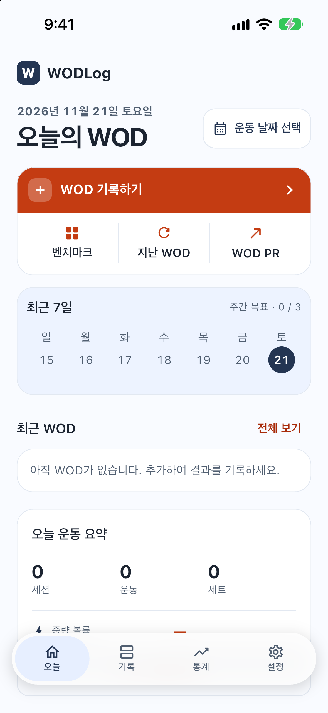 | 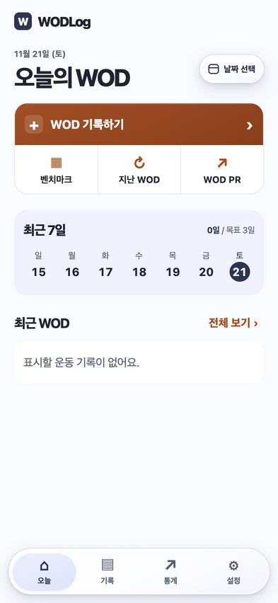 | [Full-width comparison](home-comparison-393.png) |
| 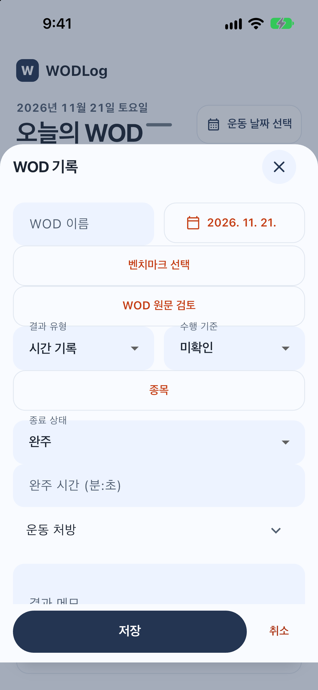 | 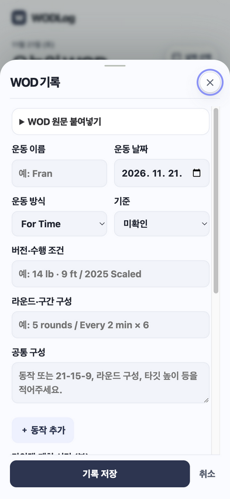 | [Full-width comparison](editor-comparison-393.png) |

The existing 393pt screenshots also show the selected Fran benchmark, entered
5:42 score, and saved record detail in `editor-score-entered-ios-15pro.png` and
`saved-detail-ios-15pro.png`. That is a real simulator save and detail flow.

## Remaining screen captures

| Acceptance item | Evidence | Result |
| --- | --- | --- |
| English home | 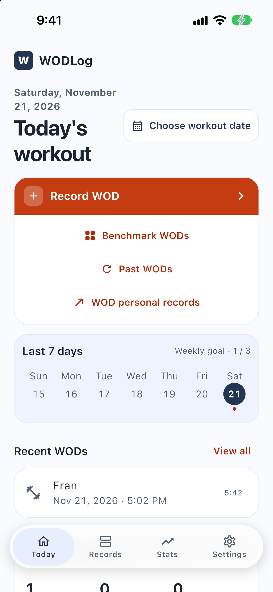 | Captured on iPhone 15 Pro; the fixed HTML mock content is Korean, so an English-to-English image comparison is unavailable. |
| Landscape and wide layout | 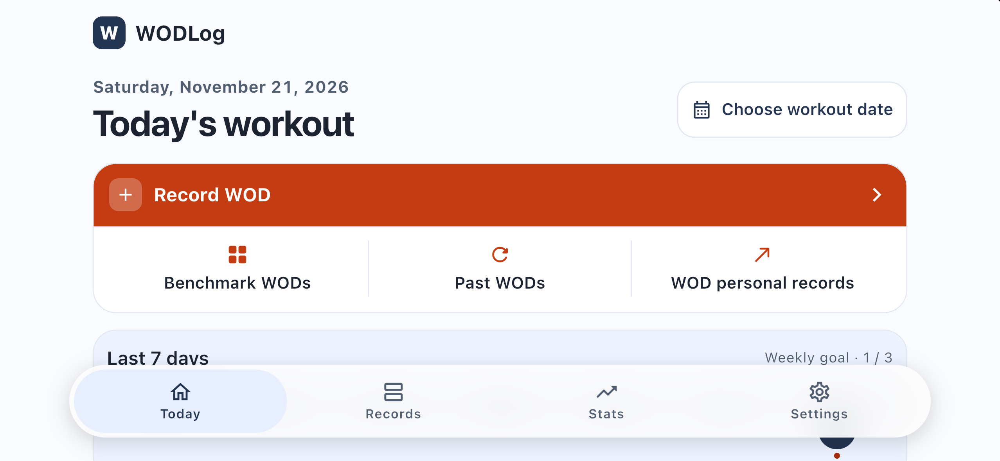 | Captured at the iPhone 15 Pro landscape size; the existing Flutter layout test also rotates the editor to 852 × 393 with an inset and checks that the focused field and fixed save action remain reachable. |
| Narrow layout, 320 × 640 | Flutter `workout_ui_test.dart` | The widget test renders 320 × 640 at 1.3× text scale in every supported locale and asserts no Flutter layout exception. This is a widget-test viewport rather than a simulator screenshot. |
| Larger accessibility text | 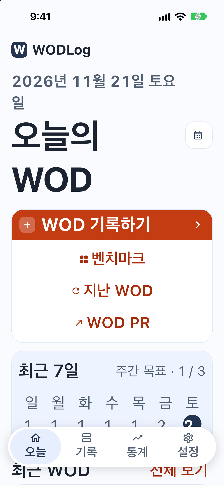, 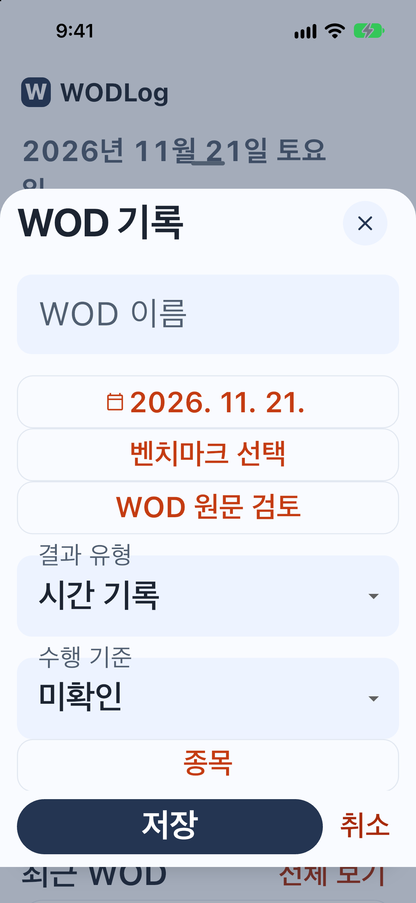 | Captured with iOS `accessibility-large` text. The editor vertically stacks paired fields and adds scaled spacing; the save and cancel actions stay fixed while fields scroll. |
| Reduce Transparency |  | Enabled in iOS Accessibility settings. The app uses its native accessibility event stream and renders the floating tab surface opaque. The simulator setting was restored to off after capture. |
| Records tab | 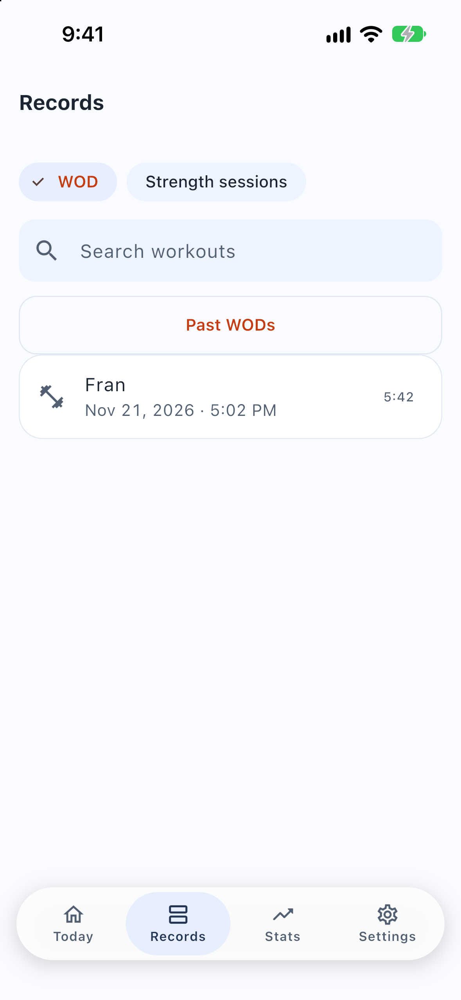 | Captured with a saved Fran result; search, WOD/strength filter, and past-WOD action are visible. |
| Stats / PR | 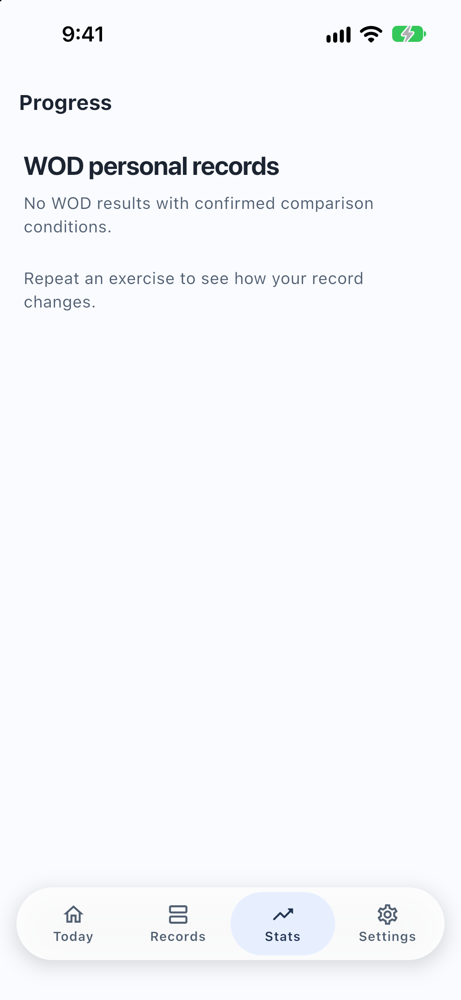 | Captured in the empty-comparison state because the saved Fran result has no confirmed comparison standard. |
| Settings | 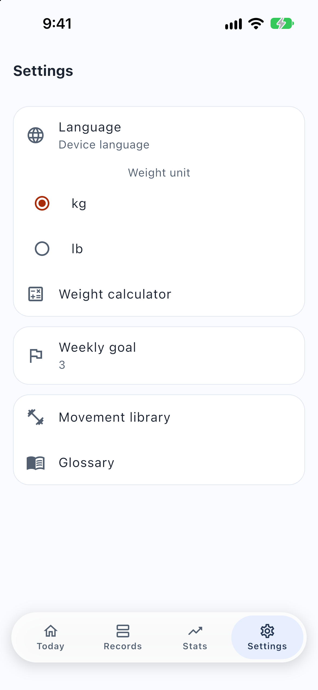 | Captured with kg/lb, weekly goal, movement library, and glossary visible. |
| iOS launcher | 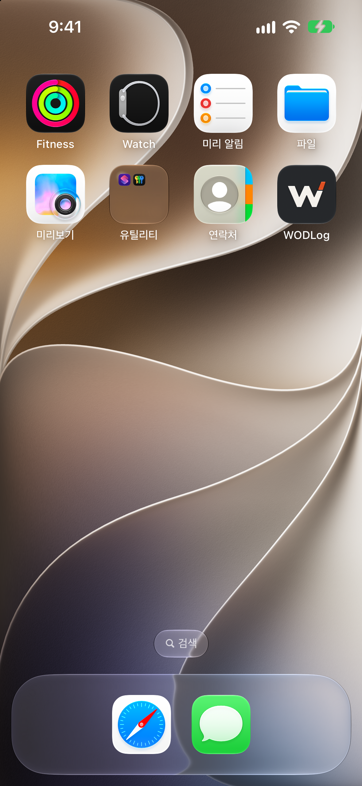 | Captured on the iPhone home screen. `assets/branding/wodlog-launcher.png` is byte-identical to the pinned approved `wodlog-app-icon.png`. |
| Android adaptive icon | — | The debug APK builds and installs on Pixel 3a API 33. The emulator launcher drawer did not open during capture, so no adaptive-mask screenshot is claimed. |
| Focused score field / actual keyboard | 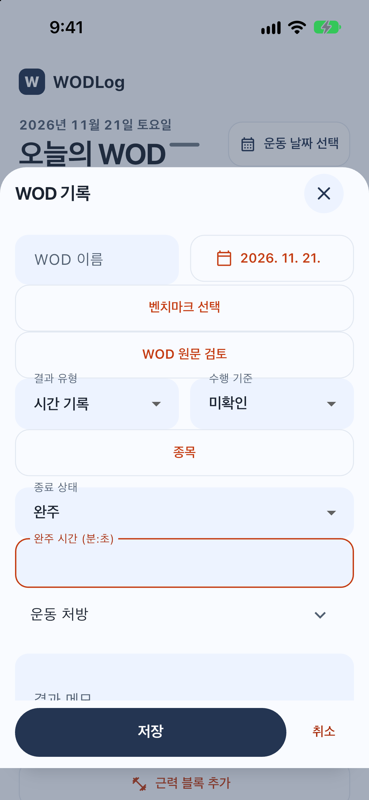 | The score field was tapped directly and shows focus/caret, but this CoreSimulator session does not render the software keyboard. The visible-keyboard save-flow acceptance item remains incomplete. |

The extra strength summary and strength-entry action below the home WOD list
remain visible in the app and are absent from the approved mock; review that
difference while preserving access to the strength flow. Other remaining
acceptance work is the actual visible-keyboard run, an English mock comparison,
screen-specific before/after comparisons for every tab, and Android adaptive
icon mask capture.

## Verification

- `flutter analyze --no-pub` — passed.
- `flutter test --no-pub` — all 64 tests passed. This includes narrow 320 × 640
  layouts across supported locales, Korean 2× text scaling, and editor scrolling,
  keyboard-inset, landscape, and fixed-save-action checks.
- `flutter build ios --simulator --no-codesign --no-pub` — passed.
- `flutter build apk --debug --no-pub` — passed with JDK 18 and installed on Pixel 3a API 33. The machine's default Java 11 is too old for the configured Gradle 9.3.1, so Flutter's JDK setting was pointed at the installed JDK 18 for this build.
- `git diff --check` — passed before this evidence update; rerun before commit.
