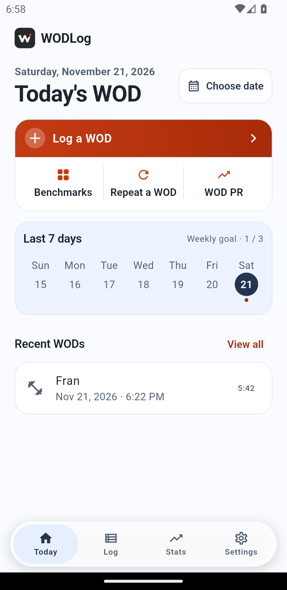
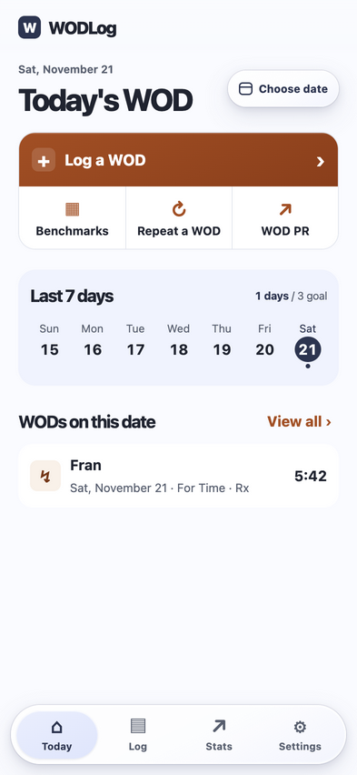
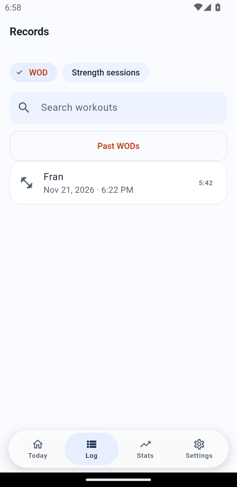
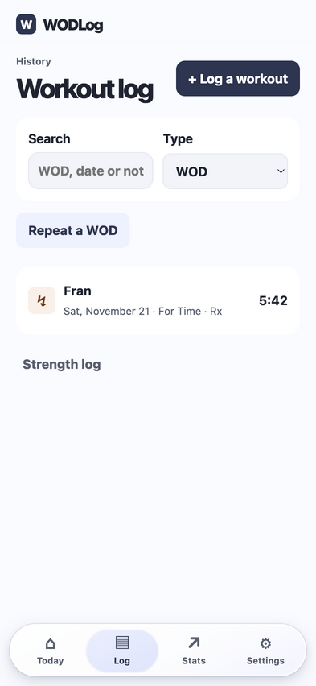
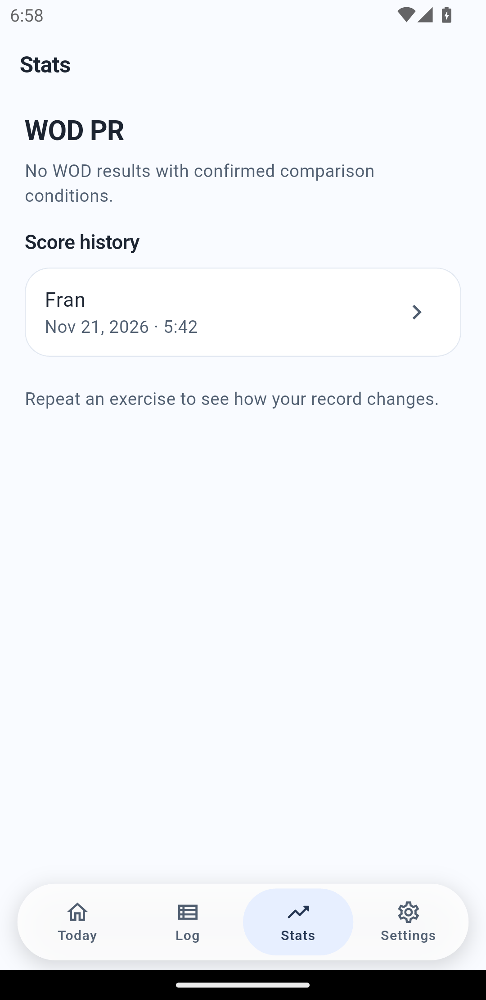
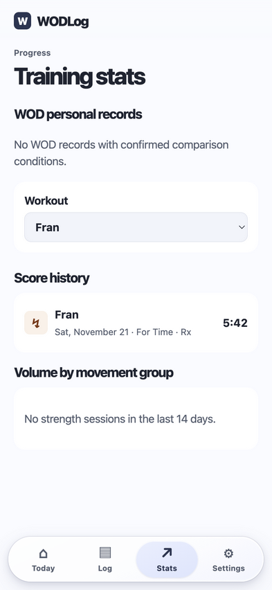
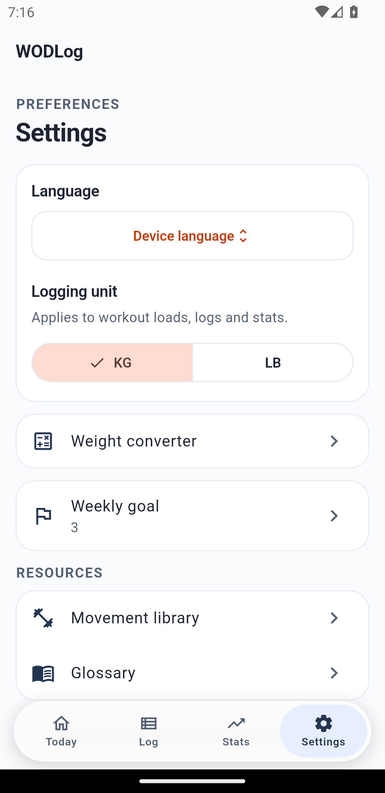
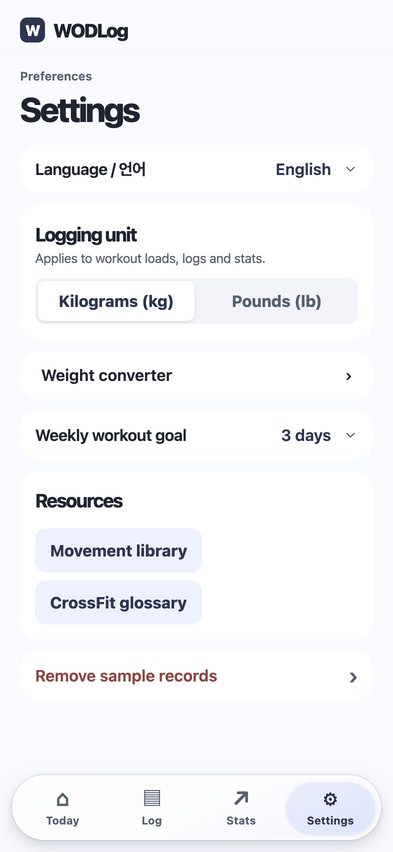

# Issue 37 UI review and evidence

## Reference

Visual review uses the pinned [HTML mock](https://github.com/rsy-dev/WODLog/blob/75fd9d3056c249d3af428923ea2f5965f8b6cad4/design/mockups/wodlog.html), the [approved launcher icon](https://github.com/rsy-dev/WODLog/blob/75fd9d3056c249d3af428923ea2f5965f8b6cad4/design/mockups/wodlog-app-icon.png), and the issue's iPhone 15 Pro build 9 comparisons. `assets/branding/wodlog-launcher.png` is byte-for-byte identical to the pinned icon; the home header now uses that asset.

## English mock comparison set

The fixed HTML mock screenshots use English, 393 × 852 CSS px, 21 November 2026, kg, and weekly goal 3. The populated mock contains Fran, For Time, Rx, 5:42. Latest app captures use the same Fran result on a Pixel 3a API 33 (1080 × 2220 physical pixels, approximately 393 × 807 logical px), so compare the layout and component treatment while accounting for Android status/navigation chrome and the shorter viewport.

| Screen | Android app | Fixed HTML mock |
| --- | --- | --- |
| Home |  |  |
| Records |  |  |
| Stats / PR |  |  |
| Settings |  |  |

The app home uses the approved W mark, date and title, orange CTA, three equal shortcut columns, blue seven-day card, recent result, and floating four-tab navigation. The settings capture shows language, kg/lb, weekly goal, converter, and resource links. The Pixel launcher capture `launcher-android-adaptive-mask.png` shows the installed icon under its circular mask. The earlier Korean empty-state comparison is `home-comparison-393.png`; HTML empty-state English is `home-mock-english-393.png`.

Earlier iPhone 15 Pro captures for home, records, stats/PR, settings, landscape, large text, and reduced transparency remain under the corresponding `*-ios-15pro.png` names. Those iOS captures predate the latest settings and brand-header refinement; the current design review is paired with the Android app captures above.

## Editor and save flow

`editor-android-final.png` shows the new-record sheet and `editor-fran-android-final.png` shows the Fran prescription. `android-keyboard-score-entered.png` captures the real Gboard visible with `05:42` entered and the fixed Save action still visible. Tapping Save opened Fran detail with a `5:42` result; see `saved-detail-android-final.png`. The approved HTML's Korean editor capture is `editor-mock-393.png`, and the app/mock editor composition is `editor-comparison-393.png`.

This verifies the editor interaction on Android; it does not satisfy the issue's iOS software-keyboard acceptance item. The earlier iPhone 15 Pro score field was focused, but that CoreSimulator did not render its software keyboard; see `editor-score-focused-no-software-keyboard-ios-15pro.png`. A final `flutter run` built and launched the app on the booted iPhone 15 Pro simulator, but both `simctl screenshot` and `flutter screenshot` returned without producing an image, so no new iOS screen or keyboard evidence is claimed.

## Layout and behavior

The Flutter UI test suite covers the 320 × 640 narrow viewport across supported locales, Korean 2× text, keyboard insets, landscape editor scrolling, and fixed-save reachability. At normal text scale, the home shortcut row keeps three columns and allows two-line labels; larger text uses the reachable stacked fallback. Strength creation remains in the Records tab after its duplicate home entry was removed. Stats keeps score history visible even when there is no confirmed PR comparison.

## Verification

- `flutter pub get` completed.
- `flutter build apk --debug --no-pub` passed; the resulting APK was installed on Pixel 3a API 33 for the captures above.
- `flutter analyze --no-pub` passed with no issues.
- `flutter test --no-pub` passed all 64 tests, including 320 × 640 supported-locale layouts, Korean 2× text, keyboard insets, landscape editor scrolling, and fixed-save reachability.
- `flutter build ios --simulator --no-codesign --no-pub` and `flutter build apk --debug --no-pub` passed; the Android APK was installed on Pixel 3a API 33.
- `git diff --check` passed after the final source and evidence updates.
- The iOS software-keyboard acceptance item remains open. The draft PR is ready for the release owner to review; Release remains with the coordinator.
