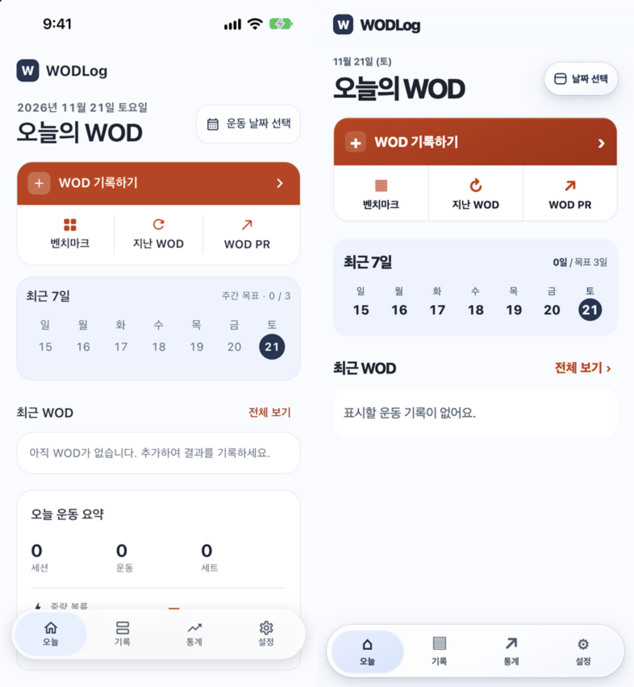
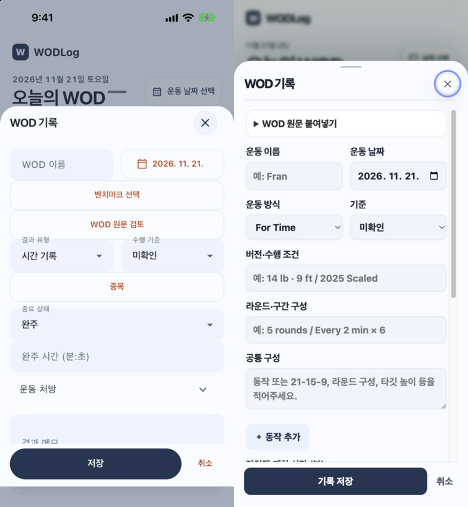

# Issue 37 visual evidence

These captures compare the fixed HTML mock at `design/mockups/wodlog.html` with
the Flutter app on an iPhone 15 Pro simulator at 393 × 852 logical points
(1179 × 2556 physical pixels, 3×). The mock renders at 393 × 852 CSS pixels.
Each comparison is a direct side-by-side composition; the iOS status bar remains
visible in the app half. The debug banner is disabled for these captures.

| Screen | Side-by-side comparison |
| --- | --- |
| Home, empty WOD state |  |
| New WOD editor |  |

Raw source captures are `home-ios-15pro.png`, `home-mock-393.png`,
`editor-ios-15pro.png`, and `editor-mock-393.png`. `editor-score-entered-ios-15pro.png`
shows Fran selected and the entered 5:42 score immediately before saving;
`saved-detail-ios-15pro.png` shows that same record after save. On this simulator,
typing into the focused score field succeeded, but the software keyboard was not
rendered in the screenshot, so the visible-keyboard acceptance item remains open.

The home comparison still shows the strength summary and strength-entry action
below the WOD section; they are not present in the approved mock and require
follow-up visual review while preserving access to the strength flow. English,
320pt and wide layouts, larger accessibility text, Reduce Transparency,
landscape, other tabs, and launcher-icon screenshots are also not covered here.
